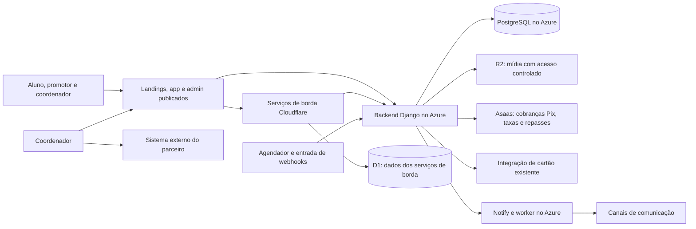

# Supletivo: regras, arquitetura e roteiro de produção

Registro de 10/10/2026. Consultas públicas de versão e saúde repetidas entre 12h35 e 12h36; leitura da instalação Azure e dos provedores entre 12h24 e 12h34, horário de São Paulo. As evidências abaixo conservam esses limites de observação.

Este documento consolida as decisões do usuário nesta conversa e as evidências da auditoria. É uma base de planejamento, sem homologação, autorização de publicação ou declaração de que a plataforma inteira funciona. Nenhum código de produto, configuração de produção, pagamento ou envio de mensagem foi alterado durante esta consolidação. A homologação pertence ao usuário.

## 1. Objetivo e limites

Entregar a operação completa: captação, autenticação, indicação, cobrança, confirmação de pagamento, documentos, matrícula no parceiro, taxas do parceiro, acesso aos estudos externos, prova presencial, documentos oficiais, entrega e repasses. Também precisam funcionar as interfaces de administração, os estados de erro, as notificações e a recuperação operacional.

- Azure permanece como base da infraestrutura. Cloudflare só pode ser utilizada conforme os serviços e limites incluídos no plano atual. Não há decisão de migração nem contratação adicional.
- Divisão de dados confirmada depois pelo usuário: usar D1 diretamente nos serviços de borda; manter PostgreSQL no Azure para os bancos principais de negócio e notify. Não está solicitada uma migração dos bancos principais para D1.
- O usuário confirmou as assinaturas Cloudflare ativas: Workers Paid, R2 Paid, Images Stream Basic e Zero Trust Teams Free Base, com renovação indicada em 27/10/2026. A inclusão de cada uso e o consumo das franquias ainda precisam ser conferidos.
- `os.v7m.live` foi abandonado pelo usuário e está excluído desta arquitetura. Isso não autoriza excluir repositório, recursos ou dados.
- Todo conteúdo exibido pelo frontend deve ser captado do backend, conforme a instrução do usuário. Preços, condições, estados, requisitos, contatos, comissões e textos comerciais precisam de origem canônica; o inventário de conteúdo deve abranger também os textos hoje fixos. Layout, componentes e tokens seguem `DESIGN.md`.
- O aluno estuda no ambiente do parceiro. A plataforma acompanha a operação, os documentos e a conclusão.
- Treinamento do promotor e referências a LMS ficam para a próxima versão. A exceção autorizada exige frontend e backend completos e funcionamento comprovado; a evidência disponível ainda não satisfaz essa condição.
- Não excluir históricos para retirar uma etapa da versão. Não enviar dados pessoais, OTP, mensagens ou operações financeiras reais como smoke test.
- A execução futura deve respeitar o isolamento de cada repositório. Este relatório foi escrito somente em `supletivo.net.br/docs/plans/production/`.

## 2. Regras comerciais confirmadas

| Entrada do aluno | Pix | Cartão | Atribuição |
| --- | ---: | ---: | --- |
| Sem indicação | R$ 1.615,00 | 12 × R$ 159,90; total R$ 1.918,80 | Promotor padrão escolhido no admin |
| Com indicação | R$ 999,00 | 12 × R$ 99,00; total R$ 1.188,00 | Autor da indicação, inclusive candidato |

O promotor padrão não transforma uma entrada sem indicação em entrada promocional. Os dois preços e a seleção do promotor padrão devem ser editáveis em `admin.supletivo.net.br`. A apresentação, o checkout e o valor efetivamente cobrado precisam derivar da mesma regra do backend.

**Vigência da tabela, confirmada pelo usuário:** alterações feitas no admin valem somente para novas propostas. Preservar valores e condições das propostas e cobranças já emitidas, incluindo as ainda não pagas. Cada proposta precisa conservar sua condição comercial e a referência da tabela aplicada; a alteração da configuração não pode recalcular esse histórico.

| Evento | Regra confirmada |
| --- | --- |
| Cadastro inicial de promotor | Entrada gratuita; candidato já recebe o link e pode indicar imediatamente |
| Ativação do promotor | Automática pelo backend após aprovação dos documentos, da identidade e conclusão do cadastro; sem treinamento |
| Matrícula paga indicada | R$ 100 de comissão para o autor da indicação |
| Quinta matrícula paga na semana | Um único bônus de R$ 500 naquela semana, mesmo que haja dez ou mais matrículas |
| Semana comercial | Sexta às 18h até a sexta seguinte às 18h, em `America/Sao_Paulo` |
| Candidato no fechamento | Valores acumulam; o recebimento fica retido enquanto não estiver ATIVO |
| Ativação depois do fechamento | Recebimento no próximo fechamento de sexta às 18h |
| Entrega do diploma | R$ 50 para o coordenador, com repasse no fechamento semanal |
| Estorno ou chargeback da matrícula | Cancelar comissão e bônus afetados ainda pendentes; descontar valores afetados já pagos dos próximos repasses |

O cálculo precisa preservar a semana de origem de cada comissão e bônus. Exemplo: quatro matrículas em uma semana e uma na seguinte não formam um bônus. Cinco em cada uma de duas semanas geram dois bônus, ainda que os valores sejam liberados juntos após a ativação. Dez matrículas na mesma semana geram R$ 1.000 de comissão e R$ 500 de bônus.

### Ativação automática confirmada pelo usuário

O backend faz a transição de candidato para ATIVO quando os documentos estão aprovados, a identidade está aprovada e o cadastro está completo. Não existe uma etapa obrigatória de aprovação final do coordenador nem treinamento para ativar nesta versão. Uma revisão humana de documento ou identidade pode alimentar as verificações; a mudança de estado ocorre automaticamente quando todos os requisitos estão satisfeitos.

A indicação já está disponível desde o cadastro inicial. Ativar altera a elegibilidade ao recebimento, preservando o mesmo autor das indicações, comissões e bônus históricos. A ativação não dispara transferência imediata: o saldo acumulado entra no fechamento semanal aplicável; se ocorrer depois do corte, entra no próximo fechamento de sexta às 18h.

A implementação precisa reavaliar as condições quando a última verificação ou informação necessária chegar, independentemente da ordem dos resultados. Documento ou identidade pendente, em revisão ou reprovado não equivale a aprovação. Atingir um limite de tentativas de selfie também não equivale a identidade aprovada. Reexecuções e decisões concorrentes devem produzir uma única ativação e manter registro do instante e das verificações que a permitiram.

### Estorno e compensação nos próximos repasses

A política confirmada é cancelar valores afetados ainda pendentes e compensar valores afetados já pagos nos próximos repasses. O extrato deve preservar o crédito original, o evento de estorno, a compensação aplicada e o saldo ainda a compensar. Não excluir a história de pagamentos.

O bônus deve ser reavaliado na semana de origem da matrícula estornada. Se cinco matrículas válidas se tornam quatro, o bônus daquela semana deixa de ser devido; se dez se tornam nove, o bônus único continua devido. Para uma comissão de R$ 100 e um bônus de R$ 500 que perderam o direito e já foram pagos, a compensação é de R$ 600. A base da compensação são os valores de comissão e bônus afetados; o preço pago pelo aluno pertence à conciliação financeira da empresa.

Como consequência técnica, o fechamento deve aplicar a compensação até o total de créditos disponíveis, transferir somente o valor líquido positivo e conservar o saldo devedor restante para os próximos repasses. Por exemplo, R$ 600 a compensar com R$ 200 de novos créditos produz repasse líquido zero e R$ 400 ainda a compensar. O cálculo do bônus de novas semanas continua baseado nas matrículas válidas dessas semanas, independentemente da compensação financeira.

Valores já associados a uma solicitação de repasse, mas ainda não pagos, também precisam ser reconciliados. Antes de cancelar ou recompor a solicitação, confirmar se o fornecedor já recebeu ou executou a transferência. Webhooks repetidos, retentativas e corrida com o fechamento não podem cancelar duas vezes, cobrar duas vezes ou recolocar uma comissão cancelada no estado pago.

**Matrícula já efetivada, decisão posterior confirmada:** o admin revisa o caso antes de suspender a matrícula; o coordenador executa as ações necessárias no sistema do parceiro. O evento financeiro e os ajustes de comissão devem ser registrados sem transformar automaticamente um estorno em suspensão de acesso externo. Registrar decisão, responsável, motivo e resultado da execução no parceiro. Taxas já pagas, agendadas, estornos parciais e contestação ainda aberta precisam constar no dossiê para a decisão do admin.

## 3. Jornada operacional confirmada

**Acesso do parceiro informado pelo usuário:** [https://cbi.sistemasiga.net/login](https://cbi.sistemasiga.net/login). O endereço identifica o destino operacional; a conversa não forneceu a razão social da instituição. A configuração local e a configuração efetiva do backend Azure `INSTITUTION_LOGIN_URL` usam o mesmo endereço, com barra final. Ainda é necessário conferir o acesso entregue em cada matrícula.

1. Aluno chega à landing, com ou sem indicação. O backend determina preço, atribuição e estado do cadastro; autenticação comprova o acesso do usuário.
2. O aluno escolhe a forma de pagamento e recebe uma cobrança oficial. Somente a confirmação financeira gera os efeitos de matrícula e comissão. Reentrega de evento não pode repetir esses efeitos.
3. A plataforma coleta e acompanha os documentos exigidos. O coordenador consulta o dossiê e resolve as revisões que dependem de intervenção humana.
4. O coordenador cria manualmente a matrícula no sistema do parceiro. Essa etapa poderá ser automatizada no futuro.
5. Dentro do nosso app, o coordenador informa Pix/QR da taxa inicial e da segunda parcela. O pagamento usa o saldo da empresa no Asaas; a segunda parcela fica agendada de forma persistente.
6. A taxa inicial precisa de confirmação real. Um registro de segunda parcela que falhou não pode ser apresentado como agendamento válido. O coordenador registra o login e a senha fornecidos pelo parceiro; o acesso atual é `https://cbi.sistemasiga.net/login`.
7. O aluno acessa o ambiente externo de estudos. Nosso app mostra o acesso recebido do backend e acompanha as pendências e etapas operacionais. O link exibido no app e o link enviado na mensagem de credenciais devem derivar da mesma informação da matrícula.
8. A prova ocorre presencialmente no polo. O coordenador registra o resultado.
9. O coordenador anexa diploma e histórico emitidos pelo parceiro e registra a entrega com foto. Esse evento gera a comissão de R$ 50 uma única vez.
10. No fechamento semanal, o sistema calcula os direitos por período, verifica a elegibilidade dos beneficiários e acompanha o repasse até a confirmação do fornecedor. Saldo insuficiente ou indisponibilidade precisa permanecer visível e recuperável.

## 4. Responsabilidade de cada app

| App ou serviço | Responsabilidade prevista | Evidência atual e trabalho necessário |
| --- | --- | --- |
| `supletivo.net.br` | Captação do aluno, condições vindas do backend, indicação e entrada no funil | Está publicado. Preço da borda diverge do backend; há conteúdo fixo e caminhos de erro que podem seguir como sucesso |
| `promotor.supletivo.net.br` | Captação gratuita e encaminhamento imediato do candidato para indicação | Está publicado. Conteúdo comercial e referência a treinamento precisam seguir as decisões atuais |
| `app.supletivo.net.br` | Jornada de aluno, candidato, promotor e coordenador; navegação conforme papel e estado | Está publicado. Existem mudanças locais importantes; candidato ainda encontra restrições de indicação e há etapas de treinamento incompatíveis com esta versão |
| Operação do polo dentro do app | Dossiê, revisões, taxas, matrícula no parceiro, credenciais, prova, documentos e entrega | `HubOperationsView.svelte` e a página de operação existem no checkout local, sem rastreamento no Git. Sua presença local não demonstra publicação ou funcionamento integral |
| Área do aluno dentro do app | Acesso ao parceiro, documentos complementares, acompanhamento e prova | `StudentActiveView.svelte` existe localmente, sem rastreamento no Git. É necessário conferir o contrato e o percurso publicado |
| `admin.supletivo.net.br` | Configuração comercial, promotor padrão, gestão e supervisão operacional | Está publicado. O formulário local de preço grava valores iguais em tabelas diferentes e não oferece a seleção explícita do promotor padrão |
| Backend Django | Autoridade de regras, identidade, estados, preços, comissões, matrícula e pagamentos | Opera no Azure; health e banco respondem. A consulta autenticada de saldo Asaas retornou 401; regras financeiras ainda divergem do negócio confirmado |
| Notify | OTP e comunicações com registro de aceitação, envio, falha e entrega quando confirmada | Worker e serviços Azure existem. Health da borda não comprova entrega; correções locais de prontidão não foram demonstradas na imagem Azure consultada |
| `version.v7m.live` | Registro da versão global e identidade das entregas | Responde `.60`; isso ainda não identifica com precisão o código servido por cada app |
| Serviços técnicos `*.v7m.live` | Webhooks, cron e outras funções de infraestrutura existentes | Precisam de origem correta, autenticação, persistência e compatibilidade com o plano atual da Cloudflare |

O app real usa Astro com componentes Svelte e React. A referência a SvelteKit em documentação antiga não deve orientar a execução sem conferir o repositório.

## 5. Infraestrutura observada e direção arquitetural

A instalação observada tem uma VM Azure `vm-v7m-core`, em `rg-v7m-core`, região `eastus`. Nela estão backend, notify, worker de notify, PostgreSQL, Evolution GO, NATS, Stalwart e conector Cloudflare. Os frontends e alguns serviços técnicos estão publicados como Workers.

Este desenho separa responsabilidades; não é comprovação de que todas as conexões funcionam. A execução deve manter o Azure como núcleo e reaproveitar serviços Cloudflare somente após verificar inclusão e consumo no plano. O inventário também precisa registrar mídia, credenciais e backups; a configuração histórica de R2 não basta para provar todos os caminhos de upload/download.

**Fronteira de dados confirmada:** PostgreSQL no Azure conserva identidade, cadastro, propostas, estados, comissões, pagamentos e registros do notify principal. Workers usam bindings D1 para os dados de sua própria borda, como ingestão e idempotência. O notify local declara `DB` ligado a `notify-db`; o health público executa uma leitura D1. A listagem remota pelo Wrangler em 10/10 retornou erro de autenticação, portanto schema aplicado, tamanho, métricas e ambiente ainda precisam de evidência. Hyperdrive existente é conexão ao PostgreSQL externo, não um banco hospedado na Cloudflare; não deve ser confundido com D1 nem utilizado para recriar regras comerciais fora do backend.

D1 está disponível no plano Workers Paid, com franquias de leitura, escrita e armazenamento; o consumo efetivo desta conta não foi obtido. Referências: [D1 e acesso por Worker](https://developers.cloudflare.com/d1/), [franquias D1](https://developers.cloudflare.com/d1/platform/pricing/) e [Hyperdrive](https://developers.cloudflare.com/hyperdrive/). A arquitetura respeita a instrução do usuário e mantém uma autoridade para cada dado.

Na conta Cloudflare autenticada foram listados os Workers da landing, promotor, app, admin, notify, cron, acesso de borda ao banco, webhooks financeiros e oráculo. A consulta de assinaturas retornou HTTP 403 e o navegador abriu a tela de login; nenhum login ou aceite foi executado. O usuário forneceu depois a relação de assinaturas ativas: Workers Paid, R2 Paid, Images Stream Basic e Zero Trust Teams Free Base. Essa relação resolve a dúvida sobre os produtos contratados; não demonstra o consumo nem ausência de excedentes. Uma tentativa posterior de listar buckets por API retornou 401 e não permitiu conferir o acesso público ao bucket.

A documentação oficial informa franquias mensais para Workers Standard e R2 Standard, com cobrança após os limites. Portanto, recursos já contratados podem ser reaproveitados, mas o planejamento precisa medir invocações, CPU, armazenamento e operações antes de ampliar o uso. Assets estáticos têm tratamento próprio; os caminhos que executam Worker precisam entrar no cálculo. Fontes: [Workers](https://developers.cloudflare.com/workers/platform/pricing/) e [R2](https://developers.cloudflare.com/r2/pricing/). Images/Stream exige conferir a franquia específica contratada; o nome da assinatura não fornece essa quantidade.

A inspeção efetiva de volumes mostrou PostgreSQL e mídia do backend e do notify-web persistidos em volumes Docker. O notify-qcluster consultado não tem volume de mídia, embora o compose local o preveja. Encontrados dois dumps de banco, backend e notify, em `runtime/backups/20261009T201517Z/` na mesma VM. Não foram lidos nem restaurados. A consulta de snapshots em `rg-v7m-core` retornou lista vazia; isso não exclui outros mecanismos de backup. Persistência local e existência de um dump não provam cópia externa, execução periódica ou restauração.

O backend efetivo tem R2 habilitado e credenciais preenchidas. `save_media` grava localmente e tenta espelhar no R2 sem propagar falha do espelhamento. A borda notify informar R2 não vinculado diz respeito a outra camada. A leitura do banco não encontrou caminho de documento que permitisse uma sondagem HEAD sem conteúdo; upload, recuperação pelo R2 e privacidade do acesso público ainda não foram demonstrados.

Na VM observada havia aproximadamente 1,9 GiB de RAM total, 396 MiB disponíveis e 1,4 GiB de swap em uso. Isso exige avaliar estabilidade e capacidade antes de acrescentar processos. Não implica, isoladamente, obrigação de contratar outra VM.

## 6. Diferenças comprovadas que impedem declarar operação completa

| Ponto | Evidência | Consequência prática |
| --- | --- | --- |
| Preços divergentes | Backend sem indicação: Pix R$ 1.615 e 12 × R$ 134,58; borda: Pix R$ 1.650 e 12 × R$ 137,50 | A condição de cartão definida pelo usuário não está implementada nessas respostas; a vitrine pode divergir da cobrança |
| Administração de preços | `PricingView.svelte` salva os mesmos valores para condições distintas | Não permite manter corretamente as duas tabelas comerciais |
| Vigência comercial | Nova regra do usuário: tabela alterada vale somente para novas propostas | Conferir snapshots e todos os leitores de preço para preservar propostas e cobranças já emitidas |
| Indicação do candidato | `validate_ref` exige promotor ACTIVE; endpoints do painel exigem papel de promotor | O cadastro inicial não consegue cumprir a indicação imediata definida pelo usuário |
| Ativação automática | Conteúdo normalizado de `promotion.py` coincide entre checkout e instalação Azure: aceita identidade verificada ou limite de selfies reprovadas, atribui treinamento e usa seus eventos | O código presente em produção precisa exigir identidade aprovada e remover o vínculo com a etapa adiada |
| Elegibilidade do repasse | O processamento examinado exige chave Pix, sem aplicar a regra completa candidato/ATIVO | Os valores retidos podem ser liberados sem satisfazer a condição de negócio |
| Estorno e compensação | Código local: `mark_refunded` cancela somente a comissão direta em `PENDING`; fechamento soma comissões pendentes sem descontar valores já pagos estornados | Falta integrar recálculo do bônus, solicitações de repasse em curso e compensação individual nos próximos fechamentos |
| Contabilização de chargeback | Código local: `resolve_dispute` pode usar `dispute.amount` no lançamento de débito de comissões; o webhook cria a disputa com o valor da cobrança | O lançamento contábil existente não demonstra compensação no repasse e precisa distinguir o valor do aluno dos direitos de comissão e bônus afetados |
| Semana e bônus | `_week_bounds` usa segunda-feira; fechamento considera pendências anteriores sem delimitar corretamente a origem semanal | Pode contar vendas de semanas diferentes no mesmo bônus |
| Asaas | GET autenticado de saldo com a configuração efetiva de produção respondeu 401 | Autenticação financeira precisa ser recuperada antes de comprovar cobrança, taxas e repasses |
| Agendador | Health do cron aponta `https://api.supletivo.net.br`; sondagens GET das rotas financeiras deram 404 nessa origem e 405, permitindo POST, na origem backend | Existe divergência de roteamento. Não foi executado POST financeiro; a execução real do cron permanece sem prova |
| Persistência de tarefas | Backend usa threads; não havia backend-qcluster ou schedules financeiros Django-Q no inventário consultado | Reinícios e indisponibilidade exigem um mecanismo durável. O cron externo existente também precisa ser considerado, evitando agendadores concorrentes |
| Segunda taxa | Conteúdo normalizado de `fees_events.py` coincide entre checkout e instalação Azure: `second is not None` vale como agendada, inclusive em caso de falha | Uma matrícula pode aparentar satisfazer o requisito sem agendamento válido |
| Link do parceiro | URL confirmada coincide com a configuração efetiva Azure. Mensagem usa URL global; app pode usar URL persistida por aluno | Unificar a origem do link enviado e exibido em cada matrícula |
| Documentos privados | Backend exige Bearer; proxy de mídia do app só encaminha headers recebidos; controles locais do polo usam links comuns para arquivos privados | A navegação de arquivos precisa de autenticação efetiva, além da proteção na API. O gate atual também concede acesso global a qualquer coordenador e precisa de conferência de escopo |
| Notify publicado | WhatsApp Connected/LoggedIn na consulta direta às 12h24. Health armazenado era de 09/10; hashes de dispatch, watchdog e settings coincidem entre web/worker, mas diferem do checkout; `notify/health.py` local está ausente no Azure | Conexão atual não prova entrega nem prontidão recente. Integrar e testar as correções existentes, publicar o mesmo artefato e confirmar atualização da monitoração |
| Publicação e versão | Oráculo `.60`; health backend `.56`, `sha` e `built_at` nulos; versões visuais distintas | Versão declarada não demonstra identidade nem integração do conjunto publicado |

No banco consultado não havia comissões, PaymentRequests ou materiais de treinamento ativos; isso não demonstra funcionamento dos fluxos. Os testes de treinamento encontrados usam respostas simuladas de API. A condição para manter treinamento nesta versão não foi comprovada.

As sondagens de saúde recentes retornaram 200 para o backend canônico, a borda notify e o cron. No notify público, o retorno informa D1 conectado, R2 não vinculado e Workers AI pronto; não informa uma entrega real. Um erro 502 observado anteriormente numa rota incorreta do backend não deve ser tratado como queda da API canônica.

As versões públicas foram reconferidas às 12h35: landing `.50`, promotor `.56`, app `.59`, admin `.50`, backend `.56` e oráculo `.60`. O backend respondeu `db: true`, zero migrations pendentes, `sha: null` e `built_at: null`. HEAD sem autenticação sobre um caminho inexistente em `documents/` retornou 401 tanto no backend quanto no app. Isso demonstra o gate anônimo para esse prefixo; não demonstra leitura autorizada de um documento existente nem isolamento entre polos.

O relatório de polo de 09/10 descreve controles faltantes. O checkout atual já contém vários desses controles. O planejamento deve conferir e integrar esse trabalho existente, sem reconstruí-lo com base na descrição antiga.

## 7. Ordem de trabalho e evidência exigida

Cada frente abaixo deve gerar uma entrega conferível no seu repositório. A operação completa exige todas as frentes; a ordem organiza dependências e não reduz a jornada prometida.

| Ordem | Entrega | Dependências | Critério técnico de conclusão |
| --- | --- | --- | --- |
| 1 | Inventário de configuração, contratos, imagens e conteúdo por app | Acesso de leitura e decisões de negócio | Registro de origem, SHA ou digest, versão, configuração efetiva sanitizada, dependências e diferenças locais/publicadas; custos Cloudflare identificados antes de novos usos |
| 2 | Backend como origem comercial e administração correta | Regras de preços, vigência e promotor padrão | Uma resposta canônica atende vitrine e checkout; admin edita tabelas separadas e padrão; novas tabelas só afetam novas propostas; snapshots e cobranças existentes preservados; atribuição sem indicação mantém tarifa regular; nenhum fallback inventa condição ou sucesso |
| 3 | Indicação imediata, ativação automática e retirada do gate de treinamento | Regra de ativação confirmada; contratos das verificações e cadastro | Link estável desde o cadastro inicial; ativação automática somente com documentos e identidade aprovados e cadastro completo; nenhuma aprovação final obrigatória do coordenador; indicação e saldo preservados; telas e APIs respeitam o mesmo estado |
| 4 | Registro financeiro, semana comercial, elegibilidade e estornos | Frente 3; integração financeira recuperada | R$ 100 por matrícula, bônus único de R$ 500 por semana, períodos sexta/18h, liberação no fechamento correto, R$ 50 por entrega; estorno cancela pendentes, reavalia bônus e compensa pagamentos anteriores sem duplicação |
| 5 | Cobrança, webhooks, agendamento e recuperação duráveis | Credenciais e origem corretas | Cobrança oficial; evento persistido; confirmação única; tarefas sobrevivem a reinício; uma origem e um responsável por cada agendamento; falhas e saldo insuficiente recuperáveis |
| 6 | Operação completa do polo e aluno | Estados financeiros e contratos de documentos | Interface real executa revisão, primeira taxa confirmada, segunda agendada, credenciais, prova presencial, documentos oficiais e entrega com foto; falhas não viram requisitos cumpridos |
| 7 | Autenticação e comunicação rastreáveis em todos os apps | Notify e canais operacionais | OTP só apresenta envio quando o resultado permitir; sessão e refresh funcionam; indisponibilidade preserva estados corretos; operador distingue aceite, envio, falha e entrega |
| 8 | Publicação do conjunto e operação assistida | Frentes anteriores; evidências e homologação do usuário | Artefato testado identificado por SHA/digest; versão global vinculada; backup restaurável; rollback descrito; percurso completo demonstrado e falhas monitoráveis |

As frentes 2 a 7 podem ter preparações independentes, mas seus contratos e a publicação precisam ser integrados. O plano não autoriza edição simultânea de outros repositórios nesta sessão.

## 8. Casos que precisam de prova além de build e mocks

- Aluno sem indicação: promotor padrão atribuído, Pix R$ 1.615, cartão 12 × R$ 159,90; aluno indicado: Pix R$ 999, cartão 12 × R$ 99. Condição exibida e cobrança oficial coincidem.
- Alteração de tabela no admin: nova proposta utiliza a nova condição; proposta ou cobrança anterior mantém os valores originais, mesmo ainda não paga. A releitura no frontend e a retentativa do checkout não alteram o snapshot.
- Candidato recém-cadastrado indica antes de concluir o cadastro. A matrícula paga mantém a autoria e acumula R$ 100; nenhuma aprovação de treinamento participa do caminho.
- Documentos, identidade e dados de cadastro terminam em ordens diferentes: a última condição satisfeita ativa automaticamente uma única vez. Pendência, revisão, reprovação, limite de selfies recusadas ou cadastro incompleto mantêm o candidato sem elegibilidade ao repasse. A rota manual existente não pode contornar os requisitos de ativação.
- Quatro, cinco e dez vendas na mesma semana; quatro mais uma em semanas diferentes; dois bônus de semanas distintas acumulados. Conferir o instante imediatamente anterior e posterior a sexta às 18h.
- Candidato continua candidato no corte: dinheiro retido. Ativação após o corte: pagamento somente no próximo fechamento. Retentativa e rota administrativa não contornam essa regra.
- Webhook repetido, fora de ordem, recebido durante indisponibilidade e com resposta perdida: nenhuma duplicação de matrícula, comissão, bônus ou repasse.
- Estorno antes do fechamento, depois de enfileirar o repasse e depois da confirmação do pagamento: cancelar valores pendentes ou registrar compensação de valores já pagos conforme o estado financeiro real. Reentrega do mesmo evento conserva um único ajuste.
- Estorno reduzindo cinco matrículas para quatro remove o bônus daquela semana; de dez para nove mantém o bônus. R$ 600 a compensar com R$ 200 de novos créditos deixa R$ 400 para fechamentos futuros, com repasse líquido zero. Se os créditos superarem o débito, transferir somente a diferença positiva.
- Estorno de matrícula efetivada abre revisão no admin; acesso externo só é suspenso após a decisão, com execução e confirmação pelo coordenador no parceiro. Ajustes financeiros e decisão acadêmica conservam históricos distintos e relacionados.
- Taxa inicial recusada, segunda parcela sem data, agendamento falho, saldo insuficiente e reinício do processador: o app mostra o estado real; dados e tarefas permanecem recuperáveis.
- Login e senha registrados para o parceiro correto; documentos acessíveis somente aos papéis autorizados; prova presencial, resultado, anexos do parceiro e foto de entrega produzindo uma única comissão de coordenador.
- OTP e envio de comunicação com canal indisponível ou entrega parcial: sem falso sucesso e sem repetir um canal já enviado.
- Usuário com múltiplos papéis, sessão expirada, suspensão e troca de estado: mesmas permissões na navegação, nas URLs e no backend.
- Restaurar backup em ambiente separado e reiniciar serviços/worker mantendo eventos, documentos e tarefas. Observar capacidade e conexões de banco.

Usar testes de regra e contrato para concorrência, dinheiro e estados; depois executar percursos em ambiente integrado com dados e provedores de teste. A comprovação final de operação real deve ser controlada, com autorização apropriada para efeitos reais e homologação do usuário. Não substituir essas evidências por uma tela com respostas simuladas.

## 9. Informações e evidências ainda necessárias

1. **Cadastro institucional do parceiro:** registrar a identificação formal nos cadastros, sem inferi-la do endereço de login. O procedimento após estorno está decidido: admin revisa antes de suspender, coordenador executa no parceiro; regras específicas sobre taxas e disputas devem ser explicitadas no procedimento de revisão.
2. **Consumo Cloudflare:** produtos contratados foram confirmados pelo usuário. Obter franquias específicas de mídia e métricas/fatura de consumo; não inferir ausência de excedentes pela existência de um recurso.
3. **Recuperação e mídia:** demonstrar restauração de banco e documentos em ambiente separado, cópia externa e periodicidade, acesso autenticado no app e ausência de exposição direta no bucket.

Esses pontos são dependências específicas de cadastro e evidência. As decisões centrais de preço, ativação, repasse, estorno e divisão de bancos já foram respondidas; o roteiro pode avançar enquanto as evidências restantes são obtidas.

## 10. Referências para execução futura

- Governança e design: `supletivo.net.br/AGENTS.md`, `supletivo.net.br/DESIGN.md`. A preferência Azure desta conversa prevalece sobre a orientação Cloudflare-first antiga.
- Contexto anterior: `docs/plans/production/audit-context-2026-10-09.md`. Suas observações são datadas; decisões de preço e versão deste documento são posteriores.
- Preços: `backend.supletivo.net.br/users/roles/lead/config.py`, `service.py`, modelo de Lead; `admin.supletivo.net.br/src/components/interactive/PricingView.svelte`; `tools/edge-postgres/src/index.ts`.
- Indicação e ativação: `backend.supletivo.net.br/users/roles/promoter/service.py`, `users/roles/candidate/`, `api/collaborators/routers/promoter.py`; componentes de candidato/promotor e guards do app.
- Conferência específica de ativação: `backend.supletivo.net.br/users/roles/candidate/promotion.py`, `selfie_ai.py`, `address_proof.py`, `coordinator.py` e `models.py`. Remover a equivalência entre limite de reprovações e identidade aprovada, o vínculo com treinamento e o texto de espera obrigatória por aprovação do coordenador. Auditar completude do cadastro e todos os caminhos de promoção antes da execução.
- Comissões e repasse: `backend.supletivo.net.br/finance/interface/commissions.py`, configuração, processamento de PaymentRequest e schedules; `tools/cron-trigger/`.
- Estorno e chargeback: `backend.supletivo.net.br/users/roles/lead/service.py::mark_refunded`, `users/roles/lead/hooks.py`, `integrations/bank/asaas/webhooks.py`, `finance/interface/ledger.py::resolve_dispute`, `finance/interface/payout.py` e `finance/models.py`. Os testes existentes de cancelamento pendente e disputa não substituem a prova de compensação no fechamento.
- Parceiro e taxas: `backend.supletivo.net.br/users/roles/enrollment/fees.py`, `fees_events.py`, `coordinator.py`; jornada do aluno em `users/roles/student/service.py`.
- Interfaces existentes: `app.supletivo.net.br/src/components/interactive/HubOperationsView.svelte`, `src/pages/hub/active/operations.astro`, `src/components/interactive/student/StudentActiveView.svelte`.
- Recuperação de mensagens: `notify.supletivo.net.br/docs/notification-production-recovery.md`. Conferir patches locais e imagem publicada antes de reaproveitar conclusões.
- Mídia: `backend.supletivo.net.br/core/media.py`, `core/media_views.py`, `integrations/cloudflare/r2.py`; `app.supletivo.net.br/src/pages/media/[...path].ts`, `src/lib/api.ts` e os links do polo/aluno.
- Infraestrutura: `deploy/azure-stack/` e instalação Azure `/opt/v7m-platform`. Handoff antigo contém descrições e configurações que precisam ser confrontadas com a instalação efetiva.
- API oficial Cloudflare para leitura das assinaturas: https://developers.cloudflare.com/api/resources/accounts/subresources/subscriptions/methods/get/ — requer acesso de cobrança; a tentativa desta auditoria retornou 403.

Nenhuma etapa está marcada como homologada. O roteiro detalhado de correção está em `production-correction-plan.md`; cada implementação futura deve detalhar suas migrations, contratos e verificações no repositório correspondente antes de executar a mudança.
